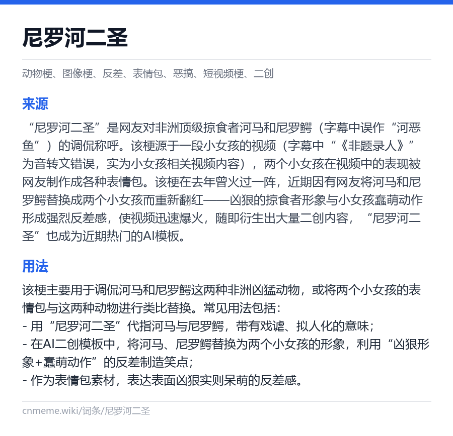

# 梗百科 · MaiBot 插件

让 [MaiBot（麦麦）](https://github.com/Mai-with-u/MaiBot) 认得群里的梗和黑话。

- 内置 **6668 条**网络梗词条，查询只要几毫秒，不依赖网络
- 本地没收录时，回落查询 [cnmeme.wiki](https://cnmeme.wiki) 公开词库
- 群友可以用 `/黑话` 自己记录群内黑话，立即生效

本插件移植自 [in1t1a1/astrbot_plugin_memewiki](https://github.com/in1t1a1/astrbot_plugin_memewiki) v1.5.2（MIT）。查词规则、问梗判断、内置词库和同步脚本都来自原插件，这里把它们接到 MaiBot 的插件 SDK 上。

> [!NOTE]
> **0.1.0 开发版。** 单元测试，以及用 MaiBot 源码做的清单、WebUI 和加载校验都已通过，但**还没有在运行中的 MaiBot 上实测**。欢迎试用并在 [Issues](https://github.com/reiki99088/maibot-plugin-memewiki/issues) 反馈。验证范围见 [docs/verification.md](docs/verification.md)。

<p align="center"></p>

## 功能

| 功能 | 说明 |
|---|---|
| 工具 `search_meme_wiki` | 模型遇到看不懂的梗、缩写、黑话时会自己调用，查询顺序：群梗 → 自定义黑话 → 内置词库 → cnmeme.wiki |
| `/梗 <词>` | 回复一张词条卡片（来源、用法、标签）；图片发不出去时改发文字 |
| `/黑话 <名称> <含义>` | 记一条群内黑话 |
| `/黑话 列表` | 查看已记录的黑话 |
| `/黑话 删除 <名称>` | 删除一条，仅限管理员 |
| WebUI「自定义黑话」页 | 在 MaiBot WebUI 的插件侧栏里增删黑话 |
| 每日同步（默认关） | 每天定时从 cnmeme.wiki 增量更新词库 |
| 预查注入（实验性，默认关） | 消息像在问梗时先查好资料，下一次回复时临时附给模型 |

## 安装

要求：MaiBot ≥ 1.3.13，maibot-plugin-sdk ≥ 2.16。

在 MaiBot 的 `plugins/` 目录下克隆本仓库：

```bash
git clone https://github.com/reiki99088/maibot-plugin-memewiki.git
```

然后重启 MaiBot，或在 WebUI 里重载插件。依赖（`aiohttp`、`Pillow`）由 MaiBot 按清单自动安装；如果没有自动安装，在 MaiBot 的 Python 环境里执行：

```bash
pip install -r requirements.txt
```

仓库里带着 16.7 MB 的内置词库 `assets/memes.db`，克隆时会一起下载，装完即可离线使用。

## 用法

**让模型自己查**：什么都不用做。群友提到模型不认识的梗时，模型会调用 `search_meme_wiki` 查资料再回复。

**查一个梗：**

```
/梗 尼罗河二圣
```

**记录群内黑话：**

```
/黑话 狗东 京东
/黑话 列表
/黑话 删除 狗东
```

记下的黑话立刻对 `/梗` 和模型查询生效，并且优先于词库：群里自己的说法比网上的解释更贴切。删除只允许本机控制台，以及配置项 `lookup.admin_users` 里的账号。

## 配置

在 WebUI 的插件配置页修改，或编辑插件目录下的 `config.toml`（首次加载时自动生成）。

| 配置项 | 默认 | 说明 |
|---|---|---|
| `lookup.reply_mode` | `image` | `/梗` 回复图片卡片（`image`）还是纯文字（`text`） |
| `lookup.online_lookup` | `true` | 本地没收录时是否查 cnmeme.wiki |
| `lookup.online_timeout` | `6.0` | 在线查询超时（秒） |
| `lookup.admin_users` | `[]` | 允许删除黑话的账号，格式 `平台:账号`，如 `qq:123456` |
| `inject.prefetch_mode` | `off` | `off`：只靠工具；`hook`：开启预查注入（实验性） |
| `inject.inject_guidance` | `true` | 预查注入时附带接梗规则 |
| `inject.guidance_text` | 空 | 自定义接梗规则，留空用内置规则 |
| `inject.search_mode` | `model` | 词库没收录时：`model` 提示模型用 `web_search` 自己查；`off` 只提示不要硬解释 |
| `inject.search_max_chars` | `10` | 不是明确在问梗时，超过这个字数的内容不当作梗 |
| `inject.wake_words` | `[]` | 额外的唤醒词；机器人昵称和别名会自动加入 |
| `sync.auto_sync_enable` | `false` | 每天自动同步词库 |
| `sync.auto_sync_hour` | `4` | 每天几点同步（0–23） |

## 预查注入（实验性）

设置 `inject.prefetch_mode = "hook"` 后：

1. 收到消息时，如果看起来像在问梗（比如「大水理论是什么梗」），先查本地词库，没有再查在线词库（最多等 1.5 秒）。
2. 同一会话 90 秒内的下一次规划请求，会在末尾临时附上这份资料。资料不写进聊天记录。

闲聊、指代性的话（「你说的」「自己发的」）不会触发联网，也不会注入。这个模式依赖 MaiBot 内部的 Hook 载荷格式，宿主升级后可能失效，所以默认关闭。关闭时模型仍然可以通过工具自己查。

## 和 MaiBot 自带黑话学习的关系

MaiBot 会从聊天里自动学习黑话（Jargon），并在回复前附上它猜的含义。本插件和它**并存，互不写入**：

- 本插件提供现成的梗词库和 cnmeme.wiki 在线查询，不重复做黑话学习。
- `/黑话` 记录的条目保存在插件数据目录的 `user_terms.json`，不写入 MaiBot 的 Jargon 表（SDK 目前没有提供写入能力）。

## 与 AstrBot 原版的差异

- 去掉了 `/网搜` 指令和插件内置的网页搜索。MaiBot 没有给插件开放搜索能力，联网搜索交给模型调用 MaiBot 自带的 `web_search` 工具。
- 卡片改用 Pillow 绘制，不依赖浏览器渲染。
- 预查注入改走 MaiBot 的 Hook，默认关闭。

完整变更见 [CHANGELOG.md](CHANGELOG.md)。

## 常见问题

**卡片里的字是方框，或者 `/梗` 只回文字？**
卡片需要系统里有中文字体。Windows 自带微软雅黑；Linux 请安装 `fonts-noto-cjk` 或文泉驿字体。找不到中文字体时插件会自动改发文字。Docker 镜像里通常没有中文字体，可以直接把 `lookup.reply_mode` 设成 `text`。

**词库多久更新？**
内置词库构建于 2026-10-26。可以开启 `sync.auto_sync_enable` 每天自动更新，也可以手动运行：

```bash
python -X utf8 scripts/sync_memes.py --data-dir <插件数据目录>
```

同步得到的词库存放在插件数据目录，优先于内置词库，更新插件不会覆盖它。

**能放一份自己群的固定词表吗？**
在插件数据目录放一个 `group_slang.json`，内容形如 `{"开黑": "一起打游戏"}`，重载插件后生效。模型查询时它的优先级最高；`/梗` 卡片不读这份词表。

## 数据来源

词条内容来自 cnmeme.wiki 的公开只读 API，版权归 cnmeme.wiki 及原作者，卡片上保留了来源链接。本插件只做本地缓存和检索。自行更新词库时请遵守站点规则：同步脚本默认每 0.35 秒请求一次，遇到 429 会退避。

## 开发

```bash
python -m venv .venv
```

```bash
.venv/Scripts/python -m pip install -r requirements-dev.txt
```

```bash
.venv/Scripts/python -m pytest
```

（Linux / macOS 把 `.venv/Scripts/python` 换成 `.venv/bin/python`。）

部分测试会读取 MaiBot 源码，用宿主自己的代码校验清单、WebUI 声明、Hook 返回的上下文条目和插件加载过程。用环境变量 `MAIBOT_SRC` 指定 MaiBot 源码目录，找不到时这些测试会跳过。

```
plugin.py          插件入口：配置、工具、命令、WebUI API、Hook、自动同步
memewiki/          与平台无关的查词逻辑（词库、问梗判断、黑话、在线查询、卡片）
assets/memes.db    内置词库
scripts/           词库同步与打包脚本
webui.json         WebUI 侧栏页声明
tests/             pytest 测试
```

## 致谢与许可证

- 原插件：[in1t1a1/astrbot_plugin_memewiki](https://github.com/in1t1a1/astrbot_plugin_memewiki)，许可证见 [LICENSE.upstream](LICENSE.upstream)
- 词条数据：[cnmeme.wiki](https://cnmeme.wiki)
- 本插件以 MIT 许可证发布，见 [LICENSE](LICENSE)
